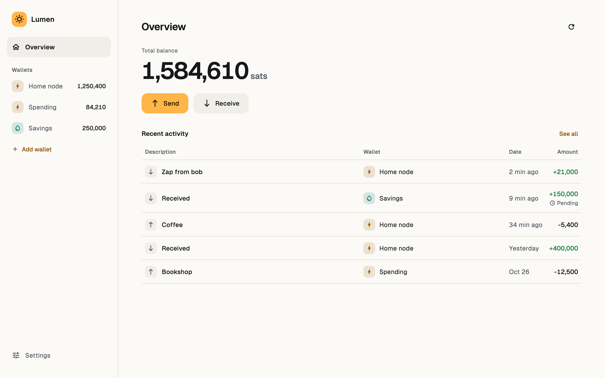
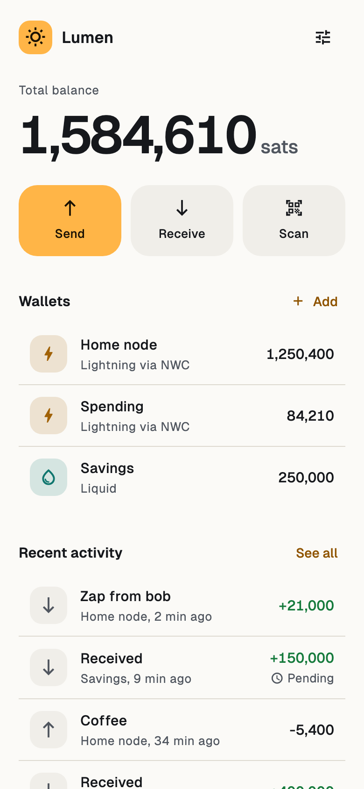
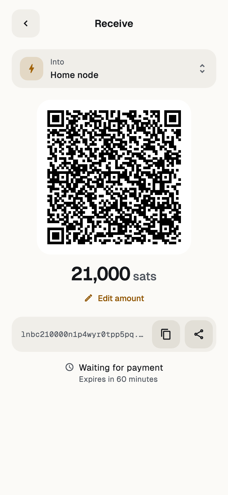
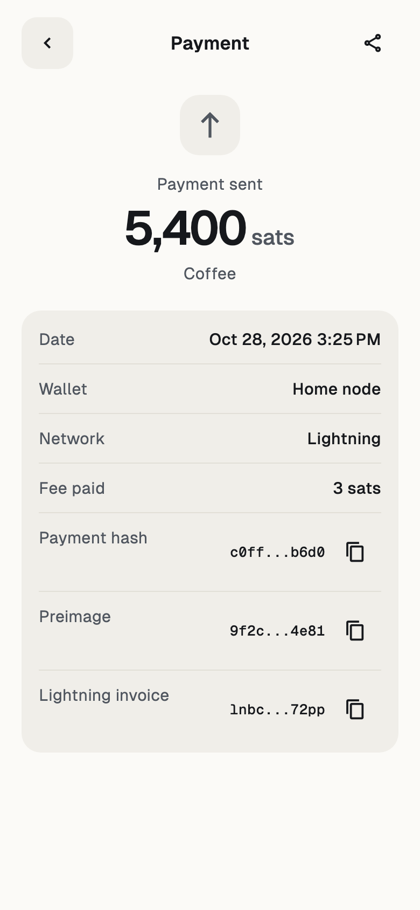

# Lumen

Every way you hold bitcoin, in one place. Lumen connects Lightning wallets over Nostr Wallet Connect (NIP-47), holds Liquid wallets of its own, shows their balances and activity together, and sends and receives with them, on Android, iOS, macOS, Windows, Linux and web.

<picture>
  <source media="(prefers-color-scheme: dark)" srcset="docs/screenshots/desktop-dark.png">
  
</picture>

<p align="center">
  <picture>
    <source media="(prefers-color-scheme: dark)" srcset="docs/screenshots/home-dark.png">
    
  </picture>
  <picture>
    <source media="(prefers-color-scheme: dark)" srcset="docs/screenshots/receive-dark.png">
    
  </picture>
  <picture>
    <source media="(prefers-color-scheme: dark)" srcset="docs/screenshots/payment-dark.png">
    
  </picture>
</p>

## Features

- **Every wallet at once.** Connect several NWC wallets, add Liquid wallets, and see one total balance and one activity feed. Before saving a connection, Lumen shows what it can and cannot do.
- **Liquid wallets.** Create one from a new 12-word recovery phrase, which Lumen asks you to type back before the wallet exists, or restore one from 12 or 24 words. The phrase never reaches the clipboard, Android and macOS keep it out of screenshots, and it can be shown again later. Lumen syncs through Waterfalls, falls back to Esplora, and lets you pick other servers in Settings.
- **Send and receive.** Pay a Lightning invoice or address, or a Liquid address with its fee shown before you confirm, and send everything a Liquid wallet holds. Create an invoice or show a Liquid address with a QR code, and get told the moment it is paid. On Android, scan QR codes with the camera.
- **Payment details.** Lightning payments keep their date, fee, payment hash, preimage and invoice. Liquid payments keep their confirmations, fee and transaction ID, with a liquid.network link that carries what the explorer needs to unblind the amounts. Each can be shared as a receipt.
- **History that stays.** Every transaction Lumen sees is saved on the device, encrypted with AES-256-GCM, so it remains readable offline.
- **App lock.** An optional passphrase, stretched with Argon2id, seals the wallets, recovery phrases included, and the history. Cmd+L or Ctrl+L locks the app at once.

## Layout

This repository is a [pub workspace](https://dart.dev/tools/pub/workspaces):

- `lib/`: the Flutter app (screens, routing, theme, app lock, local history, translations).
- `packages/lumen_wallets/`: pure Dart wallet logic behind a `Wallet` interface. The app never imports `ndk` directly.
- `packages/lumen_core/`: the Rust crate behind Liquid wallets (LWK), bridged to Dart with flutter_rust_bridge. Only `lumen_wallets` imports it.
- `test/`: widget and accessibility tests, with fake wallets in `test/fakes.dart`.
- `mockups/`: the HTML design mockups and the accessibility requirements.
- `tool/`: scripts for the app icons and the screenshots above.

## Run

```sh
flutter pub get
flutter run
```

- macOS and iOS store wallets in the Keychain, so pick your development team in Xcode (Runner target, Signing & Capabilities) before the first run.
- Linux needs `libsecret-1-dev` to build.
- Building needs Rust through [rustup](https://rustup.rs): the build compiles `lumen_core` on the stable toolchain and adds the targets it needs.
- On the web, run `tool/build_wasm.sh` first, or Liquid wallets cannot open. It needs [wasm-pack](https://github.com/wasm-bindgen/wasm-pack) and installs the nightly toolchain it builds with.

## Test

```sh
flutter test                                  # app, including accessibility guidelines
(cd packages/lumen_wallets && dart test)      # wallet logic
(cd packages/lumen_core/rust && cargo test)   # Rust core, offline
flutter test integration_test -d macos        # the Rust core as the app bundles it
```

## Screenshots

The images above are rendered from demo data by a widget test, so they follow the UI as it changes:

```sh
flutter test tool/screenshots_test.dart       # writes docs/screenshots/
```
